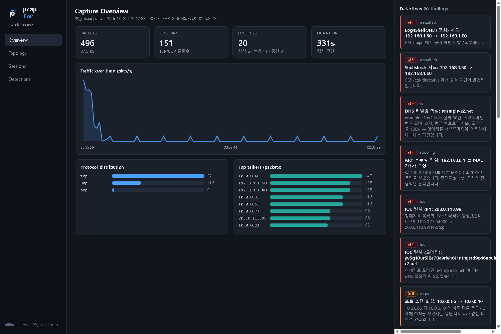
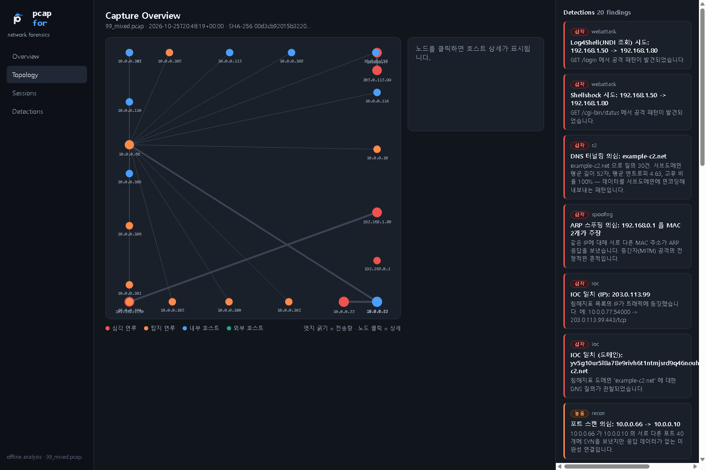
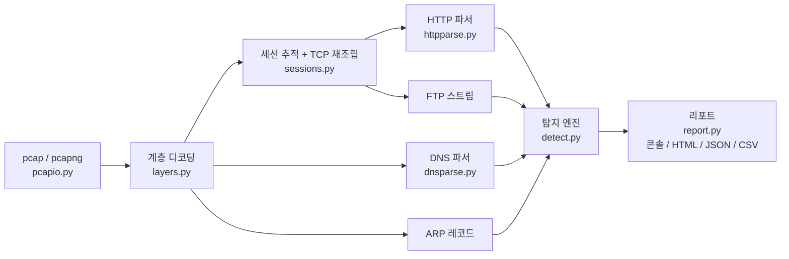

<p align="center"></p>

# pcap for

**외부 라이브러리 없이 Python 표준 라이브러리만으로 만든 PCAP 네트워크 포렌식 분석기**

pcap/pcapng 캡처 파일을 읽어 공격 흔적(포트 스캔, 브루트포스, 웹 공격, DNS 터널링,
C2 비커닝, ARP 스푸핑, 평문 자격증명 노출)을 자동 탐지하고, 근거·MITRE ATT&CK
매핑·대응 권고가 담긴 리포트와 **GUI 대시보드**를 생성합니다. 파일 분석 외에
**실시간 탐지 모드**(`--live`)로 내 PC의 트래픽을 직접 감시할 수도 있습니다.

> 컴퓨터네트워크2 수업 프로젝트.
> [ngnicky-ai/pcap-forensics-analyzer](https://github.com/ngnicky-ai/pcap-forensics-analyzer)
> (C#/.NET)에서 영감을 받아, 같은 컨셉을 Python으로 처음부터 재구현했습니다.
> 특히 "파싱에 외부 의존성을 쓰지 않는다"는 철학을 그대로 따랐습니다 —
> pcap 리더부터 TCP 재조립, DNS/HTTP 파서까지 전부 직접 구현입니다.

## 특징

- **의존성 0**: `pip install` 이 필요 없습니다. Python 3.10+ 만 있으면 동작합니다.
- **파일 포맷**: pcap(리틀/빅엔디언, 마이크로초/나노초 타임스탬프), pcapng(SHB/IDB/EPB, if_tsresol 옵션), 잘린 파일 허용
- **프로토콜 디코딩**: Ethernet(+VLAN/QinQ), ARP, IPv4, IPv6(확장 헤더 체인), TCP, UDP, ICMP, DNS(압축 포인터+루프 방지), HTTP/1.x(chunked, gzip/deflate, 파이프라이닝)
- **TCP 스트림 재조립**: 순서 뒤바뀜, 재전송, 겹침 세그먼트 처리
- **GUI 대시보드**: 다크 SOC 오버뷰 + 호스트 토폴로지 맵, 단일 HTML (서버·프레임워크 없음)
- **증거 무결성**: 입력 파일 SHA-256 기록, 모든 시각 UTC
- **합성 샘플 생성기**: Wireshark/Npcap이 없는 환경에서도 시나리오별 가짜 트래픽을 직접 만들어 검증 가능 (실제 멀웨어 없음, 전부 예약/사설 대역)

## 빠른 시작

```bash
git clone https://github.com/solmin111/pcap-for.git
cd pcap-for

# (선택) 합성 샘플 생성 — 저장소에 이미 포함되어 있음
python tools/make_samples.py

# 종합 샘플 분석
python -m pcapfor samples/99_mixed.pcap -v

# GUI 대시보드 (단일 HTML 생성 후 브라우저 자동 오픈)
python -m pcapfor samples/99_mixed.pcap --ioc iocs_example.txt --gui

# IOC 매칭 + 리포트 저장
python -m pcapfor samples/99_mixed.pcap --ioc iocs_example.txt \
    --html report.html --json report.json --csv sessions.csv
```

## GUI 대시보드 (`--gui`)

분석 결과를 다크 SOC 스타일 대시보드로 보여줍니다. 데이터가 JSON으로 내장된
**단일 self-contained HTML** 이라 서버 없이 열리고, 그대로 제출·공유할 수 있습니다.

| Overview | Topology |
|---|---|
|  |  |

- **Overview**: 요약 카드 · 트래픽 타임라인 · 프로토콜 분포 · Top talkers · 우측 실시간 탐지 피드(클릭 시 증거/MITRE/대응 펼침)
- **Topology**: 호스트 노드 그래프(자체 구현 force 레이아웃) — 내부/외부/탐지 연루 색 구분, 엣지 굵기=전송량, 노드 클릭 시 호스트 상세
- **Sessions / Detections**: 정렬 가능한 세션 테이블(탐지 연루 하이라이트), 전체 탐지 상세

실시간 모드와도 결합됩니다 — `--live --gui` 는 localhost 임시 포트에 같은 대시보드를
띄우고 2초 주기로 갱신합니다(pkt/s, 경과 시간, 실시간 탐지 피드). 서버는 127.0.0.1
전용이며 캡처 종료와 함께 내려갑니다.

### CLI 옵션

| 옵션 | 설명 |
|---|---|
| `--ioc FILE` | 침해지표 목록 매칭 (IP / CIDR / 도메인, 줄 단위, `#` 주석) |
| `--html FILE` | HTML 리포트 저장 |
| `--json FILE` | JSON 결과 저장 |
| `--csv FILE` | 세션 목록 CSV 저장 (엑셀 호환 utf-8-sig) |
| `-v` | 증거·MITRE·대응 권고까지 콘솔 출력 |

**종료 코드**: `0` 이상 없음 · `1` 오류 · `2` high/critical 탐지 존재 → 배치 자동화에 바로 사용 가능

## 실시간 탐지 (`--live`)

> ⚠ **본인이 소유하거나 관리 권한을 위임받은 호스트/네트워크에서만 사용하세요.**
> 자기 PC를 지나는 트래픽을 감시하는 방어·학습용 기능입니다.

```bash
python -m pcapfor --live                       # 실시간 감시 시작
python -m pcapfor --live --save evidence.pcap  # 캡처 증거 저장
python -m pcapfor --live --ioc iocs_example.txt --sweep 5 --duration 300
python -m pcapfor --live --gui                  # 라이브 GUI 대시보드 (localhost)
```

**관리자 권한 세션이 필요합니다** — 터미널을 "관리자 권한으로 실행"으로 연 뒤 실행하세요.
미승격 세션에서 실행하면 안내 메시지와 함께 즉시 종료합니다(종료 코드 1).

| 항목 | 내용 |
|---|---|
| 수집 방법 | Windows raw socket(`SIO_RCVALL`)으로 기본 인터페이스의 IPv4 패킷 수신 — **Npcap 등 설치물 불필요** |
| 탐지 범위 | 파일 분석과 동일한 파이프라인·탐지기 재사용 (단, 이더넷 계층이 없어 ARP 스푸핑만 제외) |
| 증거 보존 | `--save` 로 수신 패킷을 pcap 에 실시간 기록 → 나중에 파일 모드로 재분석 가능 |

탐지 스윕은 `--sweep` 초(기본 10)마다 돌고, 같은 탐지는 한 번만 알립니다.
`--duration 0`(기본)이면 Ctrl+C 로 멈출 때까지 감시하며, 종료 시 누적 탐지 수에 따라
종료 코드를 돌려줍니다. 루프백(127.0.0.1) 트래픽은 보이지 않습니다.

## 아키텍처



분석 파이프라인(`analyzer.py`)은 패킷을 한 번만 순회하며 세션 테이블과
프로토콜별 중간 산출물(`AnalysisData`)을 만들고, 탐지기들은 그 산출물만 읽습니다.
탐지기를 새로 추가하려면 `detect.py`에 함수 하나를 쓰고 `run_all`에 등록하면 됩니다.

## 탐지 항목

| 분류 | 탐지 | 판단 근거 | MITRE ATT&CK |
|---|---|---|---|
| 정찰 | 포트 스캔 | 한 출발지가 응답 없는 SYN을 서로 다른 포트 15개 이상에 전송 | T1046 |
| 정찰 | 호스트 스윕 | 같은 포트로 호스트 10대 이상 접촉 | T1018 |
| 계정 공격 | FTP 브루트포스 | 530 응답 8회 이상 | T1110 |
| 계정 공격 | HTTP 인증 브루트포스 | 동일 경로 401/403 8회 이상 | T1110.001 |
| 계정 공격 | SSH/Telnet/RDP 반복 접속 | 짧은 연결 반복 (암호화 구간은 패턴으로 판단) | T1110 |
| 자격증명 | FTP 평문 로그인 | USER/PASS + 230 성공 응답 | T1040 |
| 자격증명 | HTTP Basic / 폼 비밀번호 | Authorization 헤더, POST 본문 password 필드 | T1040 |
| 웹 공격 | SQLi · XSS · LFI · Log4Shell · Shellshock · 명령주입 | URI/본문/헤더 시그니처 (URL 디코딩 후 검사) | T1190, T1189 |
| C2/유출 | DNS 터널링 | 서브도메인 평균 길이·엔트로피·고유율 복합 판정 | T1071.004, T1048 |
| C2/유출 | DGA | 한 호스트의 고엔트로피 NXDOMAIN 다발 | T1568.002 |
| C2/유출 | 비커닝 | 연결 간격 변동계수(CV) ≤ 0.15 의 기계적 주기성 | T1071, T1573 |
| 스푸핑 | ARP 스푸핑 | 한 IP를 복수 MAC이 주장 | T1557.002 |
| IOC | IP/CIDR/도메인 일치 | 사용자 제공 침해지표 목록 | - |

임계값은 `detect.py`의 `THRESHOLDS` 한 곳에 모여 있어 튜닝이 쉽습니다.

## 합성 샘플 시나리오

`tools/make_samples.py` 가 시드 고정(재현 가능)으로 생성합니다.

| 파일 | 시나리오 |
|---|---|
| `01_portscan.pcap` | 포트 40개 스캔 + 445 포트 호스트 스윕 |
| `02_ftp_bruteforce.pcap` | FTP 로그인 9회 실패 후 성공 (평문 자격증명 포함) |
| `03_web_attacks.pcap` | SQLi, XSS, LFI, Log4Shell, Shellshock, Basic 인증, 폼 브루트포스 |
| `04_dns_tunnel.pcap` | 고엔트로피 TXT 터널링 + DGA NXDOMAIN + 정상 질의(대조군) |
| `05_beacon.pcap` | 30초 주기 C2 체크인 12회 |
| `06_arpspoof.pcap` | 게이트웨이 IP에 대한 ARP 캐시 포이즈닝 |
| `99_mixed.pcap` | 위 전부를 시간순으로 합친 종합 시연용 |

## 테스트

```bash
python -m unittest discover -s tests -v
```

22개 테스트: 포맷 리더(엔디언/나노초/잘린 파일/pcapng), VLAN·ARP 디코딩,
DNS 압축 포인터·악성 루프 방어, HTTP chunked+gzip·파이프라이닝,
TCP 순서 교정·재전송 중복 제거, 그리고 시나리오별 탐지 종단 검증.

## 한계

- 모든 패킷을 메모리에 올리므로 수 GB 캡처는 분할 후 분석 권장
- 암호화 트래픽(TLS/SSH)은 내용 대신 연결 패턴(주기성, 반복)으로만 판단
- 실시간 모드는 Windows 전용(raw socket SIO_RCVALL)이며 관리자 권한 필수. ARP·루프백·IPv6은 미수신
- 시그니처 기반 웹 공격 탐지는 우회 가능 — 학습용 기준선으로 이해할 것

## 라이선스

MIT
